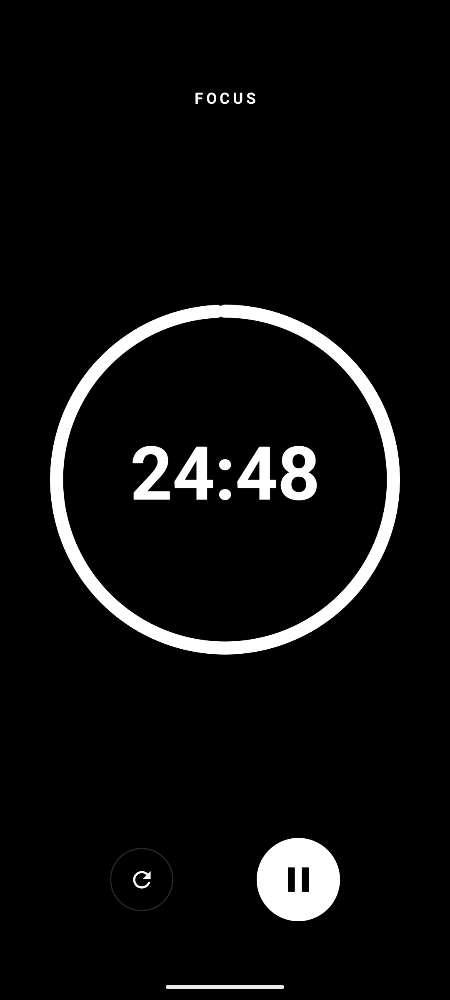
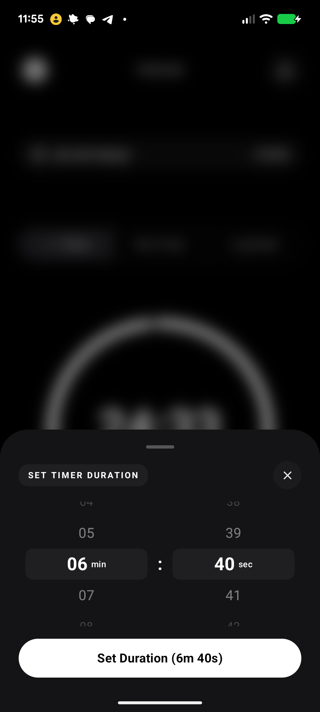

# Focus — Minimalist Focus & Task Manager App

[](https://github.com/bendeze/focus-app/releases)
[](https://github.com/bendeze/focus-app/actions)
[](LICENSE)

Focus is an offline-first, high-performance Android application designed for deep productivity, pomodoro-style focus sessions, and structured project management. Built using modern Jetpack Compose, Kotlin Coroutines, Room Database, and Retrofit.

---

## Visual Preview

| Home Timer Screen | Active Focus Session | Tasks & Projects Sheet | Apple Wheel Timer Picker |
| :---: | :---: | :---: | :---: |
|  |  |  |  |

---

## Download & Install

You can download the pre-compiled Android APK directly from the [GitHub Releases Page](https://github.com/bendeze/focus-app/releases):

1. Download **`focus-app-v1.0.0.apk`** from the latest release.
2. Transfer or open the `.apk` on your Android device (Android 7.0+ / API 24+).
3. Tap **Install** (allow *"Install from unknown sources"* if prompted).

---

## Key Features

- **Minimalist Monochromatic Design:** High-contrast OLED dark/light theme for zero visual clutter.
- **Biometric Fingerprint Authentication:** Instant local sign-in via `androidx.biometric`.
- **Custom Timer Engine:** Pomodoro presets (Focus, Short Break, Long Break) plus an Apple-style wheel picker for custom minutes and seconds.
- **Task & Project Management:**
  - Dynamic local calculation of project completion metrics.
  - Project organization with standalone inbox tasks and child project tasks.
  - Real-time remaining focus time updates (`PAUSED • Rem: Xm Ys`).
- **Offline-First Synchronization:**
  - 0ms local mutation speed backed by Room SQLite DB.
  - Offline user authentication and credential caching (SHA-256).
  - Background 2-way delta sync (`SyncEngine`) with automatic conflict resolution and `X-Idempotency-Key` headers to prevent duplicate creations.
- **Audio & Haptic Experience:** Customizable 15s countdown sound styles (Beep, Tick, Mute) and timer end alarms with vibration feedback.
- **Do Not Disturb Interop:** System Do Not Disturb permission handling and screen pinning lock integration.

---

## Prerequisites

Before building the project from source, ensure your development environment satisfies:

- **Android Studio:** Ladybug (2024.2.1+) or newer
- **Java Development Kit (JDK):** JDK 17
- **Kotlin:** 2.0.21+
- **Min Android SDK:** API 24 (Android 7.0)
- **Target Android SDK:** API 35 (Android 15)

---

## Build & Setup Instructions

### 1. Clone the Repository
```bash
git clone https://github.com/bendeze/focus-app.git
cd focus-app
```

### 2. Configure Local Properties
Create or verify `local.properties` in the project root directory and specify your Android SDK location:
```properties
sdk.dir=/Users/your-username/Library/Android/sdk
```

### 3. API Base URL Configuration (Optional)
Network endpoints are configured via `local.properties` environment variable:
```properties
BASE_URL=https://api.yourdomain.com/
```
*(To use a local development server, update `BASE_URL` to point to `http://10.0.2.2:8000/` for Android Emulator).*

### 4. Build and Run via Command Line
- **Run Unit Tests:**
  ```bash
  ./gradlew testDebugUnitTest
  ```
- **Build Debug APK:**
  ```bash
  ./gradlew assembleDebug
  ```
  The generated APK will be available at `app/build/outputs/apk/debug/app-debug.apk`.

### 5. Run on Device / Emulator
Open the project in Android Studio, select your Target Device (Emulator or Connected Physical Device), and click **Run 'app'** (`Shift + F10`).

---

## Technical Architecture

- **UI Framework:** Jetpack Compose with Material 3.
- **Architecture Pattern:** MVVM (Model-View-ViewModel) + Reactive Unidirectional Data Flow (`StateFlow` & Room `Flow` streams).
- **Local Persistence:** Room Database (`ProjectDao`, `TaskDao`, `FocusSessionDao`).
- **Networking:** Retrofit 2 + Moshi + OkHttp.
- **Biometric Security:** `androidx.biometric` BiometricPrompt API.
- **Asynchrony:** Kotlin Coroutines & `Flow`.

---

## Community & Open Source Governance

- [Contributing Guidelines](CONTRIBUTING.md)
- [Security Policy](SECURITY.md)
- [Changelog](CHANGELOG.md)
- [License (MIT)](LICENSE)
